  

  
  

## Hi, I'm Amir 👋

I'm a product leader who builds where software meets the real world: AI agents that run a clinic's patient flow, a 32-channel Bluetooth sensor hub that went to a 5,000-unit production run, and a cuffless blood pressure platform with iOS, Android and a cloud AI (Artificial Intelligence) model.

I started as an electrical and embedded systems engineer, so I can sit with firmware, mobile, cloud and data teams and speak their language. That is how I keep multidisciplinary teams moving from the first idea to a smooth release.

## What I work on

| 🤖 Agentic AI | 🩺 Connected health | 🔧 Hardware |
|---|---|---|
| LLM (Large Language Model) agents, RAG (Retrieval-Augmented Generation), tool use, evals and human-in-the-loop guardrails | Wearables, companion apps, clinical workflows, EMR (Electronic Medical Record) integrations | BLE (Bluetooth Low Energy) sensor hubs, firmware, stage-gates from prototype to mass production |

## Featured

| Project | What it shows |
|---|---|
| [**agentic-intake-copilot**](https://github.com/AmirPournajib/agentic-intake-copilot) | A tested reference for agentic workflows: agent roles, typed tools, guardrails in code, a human-review gate, full traces, and an eval set that runs in CI (Continuous Integration). Comes with a one-page product brief. |
| [**cuffless-bp-companion**](https://github.com/AmirPournajib/cuffless-bp-companion) | React Native app for iOS and Android: Bluetooth streaming from an ECG and PPG watch, pulse transit time, per-user cuff calibration, offline sync, and a release checklist. A demo inspired by the HealthGauge platform I led, on synthetic data. |
| [**smart-jacket-firmware**](https://github.com/AmirPournajib/smart-jacket-firmware) | C firmware for the Edge AGI Wearables smart jacket concept: fall detection, an int8 on-device activity model, heart rate, heated zones with safety cut-offs, and a voice link to a local model on a Jetson Nano. Runs in simulation with 221 checks in CI. |
| [**Portfolio**](https://amirpournajib.github.io) | Case studies: AI agents at My Fertility Labs, the Texavie sensor hub, and HealthGauge connected health. |
| [**oxygen**](https://github.com/AmirPournajib/oxygen) | The Oxygen Method, a runway-first decision framework for product and program managers that I co-created. |
| [**circuitmind-studios**](https://github.com/AmirPournajib/circuitmind-studios) | React and Tailwind site for my machine learning workshops, coaching and proof-of-concept services. |

## Experience

- **Senior Technical Product Manager, AI and Mobile**, My Fertility Labs (2024 to 2026): patient app, clinic platform, EMR integrations and Copilot agents on Azure.
- **Technical Product Manager, Hardware and Firmware Lead**, Texavie Technologies (2022 to 2024): led hardware, firmware, mobile, cloud and AI through stage-gates to a 5,000-unit production run.
- **Product Manager, Connected Health and AI**, HealthGauge (2019 to 2022): roadmap for a cuffless blood pressure platform across a watch, iOS, Android, web and a cloud AI model.
- **Co-founder**, Edge AGI Wearables (2026, side venture): a smart jacket running AI models locally on an NVIDIA Jetson Nano.

## Toolbox

**Education:** M.Sc. Computer Science (AI, Robotics and Computer Vision), University of Alberta · B.Sc. Electrical and Electronics Engineering

**Certifications:** PMP (Project Management Professional) · Lean Six Sigma Green Belt · Google Project Management Certificate

📍 North Vancouver, BC · Open to product leadership roles in AI, connected devices and health tech
